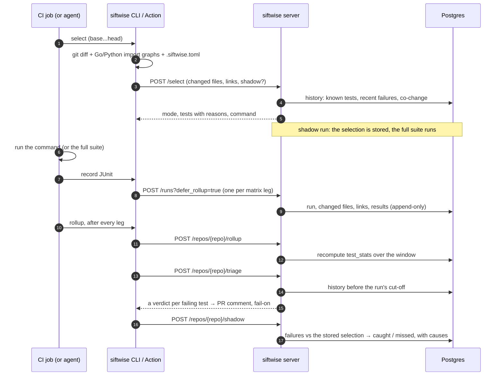

# Architecture

How siftwise is put together: the components, what happens on one CI run, the data model,
and the design rules everything else follows. For setup, see the [README](README.md); for
how the evals measure, [eval methodology](docs/eval-methodology.md).

## Components

| Component | Runs | Does | Install |
|---|---|---|---|
| **CLI** (`siftwise`) | on a laptop or a CI runner, in the checkout | `select`, `record`, `triage`, `report`, `rollup`: computes the git diff and the Go/Python import graphs, then calls the API | `pip install siftwise` (typer, httpx, defusedxml) |
| **GitHub Action** (`actions/select`, `record`, `rollup`) | in GitHub Actions jobs | composite actions around `siftwise gha ...` (`cli/gha.py`): run metadata, the sticky PR comment, job summaries, re-runs, `fail-on` | installs the light CLI from the action's checkout |
| **GitLab CI template** (`gitlab/siftwise.gitlab-ci.yml`) | in GitLab CI jobs | hidden jobs around `siftwise gitlab ...` (`cli/gitlab.py`): the same steps, with dotenv outputs, `.siftwise-ci/` reports and the sticky merge request note | `pip install siftwise==<the template's release>` |
| **MCP server** (`siftwise mcp`) | started by a coding agent, over stdio | `select_tests`, `triage_failure`, `explain`: the same change computation as the CLI, including uncommitted work | `siftwise[mcp]` |
| **API server** (FastAPI) | one or more stateless workers | ingest, rollups, selection, triage, shadow comparison, recall | `siftwise[server]`, or the Docker image |
| **Postgres** | one database | every raw result and every derived table; the only state | Postgres 16 in the compose file |

The split is deliberate: **graphs are computed by the client, in the checkout, never by the
server**, so the server needs no access to source code and the light CLI needs no database
libraries.

## One CI run, end to end

1. **Select** (`POST /select`). The client sends the changed files, what they link to (Go
   `affected_packages`, Python `affected_files`, `[[depends]]` rules, generated globs) and
   `.siftwise.toml`'s `always_run`. The server loads history from `test_stats` and the failed
   results, and returns `mode` (`selective` or `full`), every selected test with its reasons,
   counts, an estimated time and a ready-to-run command. With `shadow` set, it also stores the
   selection (`shadow_selections`) for the comparison in step 6.
2. **Run.** The CI job runs the command, or its own full-suite command when `mode` is `full`.
3. **Record** (`POST /runs`). One upload per matrix leg (`variant`): JUnit files plus the run's
   metadata, changed files and the change's links (`runs.affected`) as the CLI computed them.
   Re-uploads of the same `(repo, ci_run_id, run_attempt, variant, rerun)` are no-ops.
4. **Rollup** (`POST /repos/{repo}/rollup`). Per-test history (`test_stats`: runs, failures,
   flaky score, broken on main, average duration, last seen) is recomputed over the stats
   window, once per CI run after every leg.
5. **Triage** (`POST /repos/{repo}/triage`). Every failing test of the CI run attempt, per
   variant, gets a verdict from history before the run. The Action writes them into the PR
   comment and applies `fail-on`.
6. **Shadow compare** (`POST /repos/{repo}/shadow`). For a shadow run, each failure is checked
   against the stored selection: caught, missed (with a cause), or flaky (counted apart).
   `GET /repos/{repo}/recall` and `siftwise report` aggregate the results.

The MCP server and `siftwise triage` use the stateless variants: `POST /triage` with failures
from local JUnit files, and `POST /explain` for one test.

## Data model

| Table | Holds | Key points |
|---|---|---|
| `repos` | one row per repository name | |
| `runs` | one upload: a CI run attempt's matrix leg | unique `(repo, ci_run_id, run_attempt, variant, rerun)`; `commit_sha`, `branch`, `is_main`, `started_at`; `changed_files_known`; `affected` (the change's links, NULL if a graph failed or the run was backfilled); `known_flaky` (the globs triage applies to it) |
| `changed_files` | `(run_id, path)` | the run's diff |
| `tests` | a test's identity, once per repo | `test_id` = `classname::name`; `file_path` with the time it was reported |
| `test_results` | raw results, append-only | `(run_id, test_key, attempt)`; status, duration, message (4 KB max); partial indexes on failures, by run and by test |
| `test_stats` | per-test rollup, recomputed, never incremented | only tests seen in the stats window |
| `shadow_selections` | what siftwise would have run, per attempt and variant | the selection scope `WouldRun` reads |
| `shadow_results`, `shadow_failures` | each compared run, and each of its failing tests | caught or missed, verdict, miss cause, suggested rule |

- **Run time** is `COALESCE(started_at, created_at)` everywhere "latest" matters: backfill
  ingests old runs late.
- **A test's outcome in a run** is its final attempt's status; `error` counts as a failure.
- **Variants are compared only with themselves**: a test passing on Linux and failing on
  macOS is a platform difference, not flakiness. The selector ignores variants.

Migrations live in `src/siftwise/migrations` and ship in the wheel; see
[CONTRIBUTING.md](CONTRIBUTING.md#migrations).

## Selection

- **Signals:** path mapping (`foo.py` → `test_foo.py`, Go package directories, JS/TS test
  files), Go and Python import graphs, `[[depends]]` rules, nested build files (scoped to their
  directory), co-change from past failing runs, tests that failed recently on main, and
  `always_run`.
- **Whole files and packages:** a changed or imported test file runs whole, and a changed Go
  package runs without `-run`, so tests added by the change run too.
- **Full-suite fallbacks**, when anything is uncertain: an unknown or empty diff, no history,
  a root build or CI file changed, a changed source file no signal covers, or a selected test
  with no known runner. Docs, lint-only configs and generated files never force it.

## Triage verdicts

The first rule that applies decides:

| # | Situation | Verdict | Confidence |
|---|---|---|---|
| 1 | The same commit and variant passed before, or passed on one of this run's re-runs | **flaky** | high |
| 2 | Failing on main for this variant at the last main run before this one | **pre-existing** (a `known_flaky` listing is only noted) | high for a streak of 2+ main runs or a matching message, else medium; at most medium if the change also links to the test |
| 3 | The diff is unknown | **unknown** | low |
| 3b | Listed in `known_flaky` | linked to the change: **unknown**, re-run to tell; else **flaky** | low; flaky: medium, high with strong flaky history |
| 4 | No history before this run | **new regression** if the test's own file changed (medium), else **unknown** | |
| 5 | Linked to the change, with flaky evidence | **unknown**: re-run to tell | low |
| 6 | Linked to the change | **new regression** | high: the test's file or path mapping; medium: an import, a `[[depends]]` rule or a nested build file; low: a root build/CI file. One level lower without a passing main run to compare with |
| 7 | Not linked, with flaky evidence | **flaky** | high with 2+ events or a matching message, else medium |
| 8 | Not linked, no flaky evidence | **unknown** | low |

- **Linked** means the selector's change-based signals only (file, path mapping, imports,
  `[[depends]]`, build files). History signals (co-change, recently failed, always-run) never
  link a failure to *this* change.
- **Flaky evidence** comes in two kinds, counted apart: a fail and a pass on one commit and
  variant; or a failure on a run whose change didn't link to the test, then a pass on the
  branch's next run, whose change didn't either.
- **Failure messages** are evidence only: normalised, a match raises confidence and a mismatch
  is noted, never decisive.
- `unknown` always has low confidence. Triage never guesses.

## Shadow comparison

- The unit is a test in one CI run attempt. It's flaky only if triage called it flaky on every
  failing leg, and missed if any non-flaky failing leg's selection wouldn't have run it.
- Whether a selection "would have run" a test is decided by the same code (`WouldRun`) that
  the evals use, from the stored selection, never by re-selecting.
- Each miss gets a cause, the first that the evidence supports: `new_test`, `flaky_history`,
  `unknown`, `config_gap`, `no_link`. Only `config_gap` gets a suggested `[[depends]]` rule,
  shown and never applied.
- A run counts as selective only if every compared leg's selection was; full-suite fallbacks
  catch everything, so the report always shows the selective-only recall next to the overall
  one.

## Design rules

- **No peeking.** Triage, the replay evals and shadow verdicts use only runs strictly before
  the cut-off (by run time, then id), and never another upload of the same CI run attempt; the
  one exception is the attempt's own re-runs, for rule 1. A test's file path counts only if it
  was reported before the cut-off. `test_stats` (which includes later runs) is never used in
  triage. Triaging an old run gives the answer it would have got live.
- **Fail open.** An unreachable server, a timeout, an HTTP error or a missing token makes
  `select` run the full suite and `record`/`rollup` warn; the MCP tools say to run the full
  suite or that verdicts are unavailable. siftwise never fails CI, except through `fail-on`,
  which the user opts into and which then fails closed: unavailable verdicts fail the step, so
  an outage can't let a regression through.
- **Base-branch `known_flaky`.** For a pull request, `record` stores the base commit's
  `known_flaky` list (`git show <base>:.siftwise.toml`), so a PR can't mark its own failures
  flaky and pass `fail-on`; its own changes to the list apply after merge. This assumes the
  workflow file itself is protected.
- **Change links are stored at record time.** `record` sends the links the change had in that
  checkout (`runs.affected`); triage on the server reuses them instead of rebuilding graphs. A
  graph that failed or was skipped stores NULL, which triage treats as an unknown change,
  never as "known, with no links" (that would make an import-only regression look unrelated,
  and so flaky).
- **Conservative selection.** When unsure, run the full suite: missing a real failure is worse
  than running extra tests.
- **Stateless workers, append-only raw data.** All state is in Postgres; raw results are never
  changed; `test_stats` can be rebuilt from them at any time. Ingest is idempotent, and a
  concurrent duplicate upload loses a unique-index race and returns the winner's run.
- **Deferred rollups.** A matrix leg's upload skips the rollup (`defer_rollup=true`); one repo
  rollup runs after all legs, under a per-repo advisory lock, in memory-bounded batches.
- **One token, failing closed.** Every path but `/healthz` and the API docs needs the bearer
  token, checked before the body is read; an unset `SIFTWISE_API_TOKEN` returns 503.
- **Migrations at start, once.** `siftwise server start` migrates under a Postgres advisory
  lock, so replicas starting together migrate once.
- **One CI flow, two providers.** `select`, `record` and `rollup` are the same code for GitHub
  Actions and GitLab CI (`gha.run_select`, `run_record`, `run_rollup`). A `Provider` decides only
  how a step reports: outputs (`$GITHUB_OUTPUT`, or a dotenv file for later GitLab jobs), logs,
  summaries, the comment (issue comments, or merge request notes) and Markdown escaping. GitLab
  reads the pipeline from its predefined variables. A merge request records its source commit,
  never a merged results commit, as GitHub records the PR head.
- **Secrets from the environment only; untrusted text inert.** The GitLab jobs take no token
  options and redact every token value from logs, files and the note. Test IDs, paths and
  reasons come from the change's code. Both the GitHub comment and the GitLab note show them as
  code spans only (no links, HTML, mentions or autolinks), and the GitLab note lets no line
  start a quick action. A fork merge
  request's pipeline has no tokens; elsewhere, a missing token makes `fail-on` fail closed.
- **Re-runs through each test's own runner.** `record`'s `rerun-unknown` (`cli/reruns.py`)
  picks a runner per failing test from its recorded ID and file and the checkout (pytest, Go,
  Jest, Maven, Gradle), builds commands that run exactly those tests (escaped regexes, Java
  names restricted to identifiers, no shell), and reads back JUnit reports that must name the
  tests as the CI run did; `go test -json` output is converted to JUnit by siftwise. Each
  round's reports are one upload (`rerun = n`); triage rule 1 then reads a pass as flaky.
  Maven's and Gradle's re-runs write into the CI run's report directories, so those reports
  are backed up first and put back after, whatever happened. A test that can't be matched (no runner, a different name in the re-run's report) keeps its
  verdict.

## Performance

A fixed number of queries per request, whatever the number of failures or matrix legs:
triage of a CI run attempt uses at most 17 queries (12 on rdflib's 22-leg attempt), and a
shadow comparison 27. `/select` reads
passing results only through `test_stats`. Measurements and the before/after numbers:
[eval results, Performance](docs/eval-results.md#performance).
