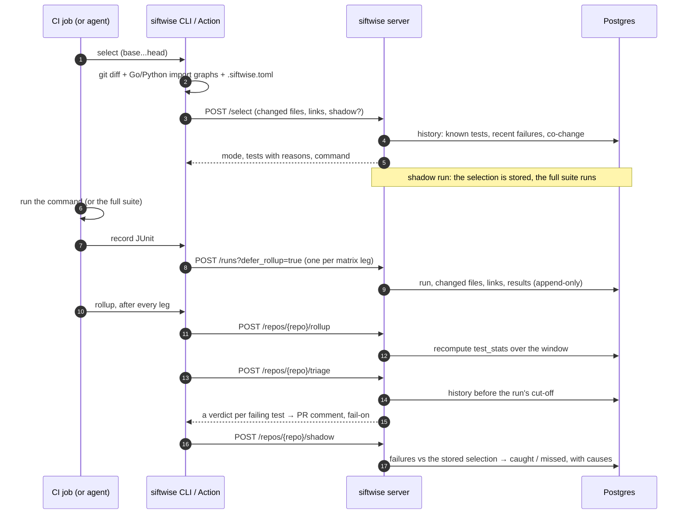

# Architecture

How siftwise is put together: the components, what happens on one CI run, the data model,
and the design rules everything else follows. For setup, see the [README](README.md); for
how the evals measure, [eval methodology](docs/eval-methodology.md).

## Components

| Component | Runs | Does | Install |
|---|---|---|---|
| **CLI** (`siftwise`) | on a laptop or a CI runner, in the checkout | `select`, `record`, `triage`, `report`, `rollup`: computes the git diff and the Go/Python import graphs, then calls the API | `pip install siftwise` (typer, httpx, defusedxml) |
| **GitHub Action** (`actions/select`, `record`, `rollup`) | in GitHub Actions jobs | composite actions around `siftwise gha ...` (`cli/gha.py`): run metadata, the sticky PR comment, job summaries, re-runs, `fail-on` | installs the light CLI from the action's checkout |
| **GitLab CI template** (`gitlab/siftwise.gitlab-ci.yml`) | in GitLab CI jobs | hidden jobs around `siftwise gitlab ...` (`cli/gitlab.py`): the same steps, with dotenv outputs, `.siftwise-ci/` reports and the sticky merge request note | `pip install siftwise==<the template's release>` |
| **MCP server** (`siftwise mcp`) | started by a coding agent, over stdio | `select_tests`, `triage_failure`, `explain`: the same change computation as the CLI, including uncommitted work | `siftwise[mcp]` |
| **API server** (FastAPI) | one or more stateless workers | ingest, rollups, selection, triage, shadow comparison, recall | `siftwise[server]`, or the Docker image |
| **Postgres** | one database | every raw result and every derived table; the only state | Postgres 16 in the compose file |

The split is deliberate: **graphs are computed by the client, in the checkout, never by the
server**, so the server needs no access to source code and the light CLI needs no database
libraries.

## One CI run, end to end



1. **Select** (`POST /select`). The client sends the changed files, what they link to (Go
   `affected_packages`, Python `affected_files`, `[[depends]]` rules, generated globs) and
   `.siftwise.toml`'s `always_run`. The server loads history from `test_stats` and the failed
   results, and returns `mode` (`selective` or `full`), every selected test with its reasons,
   counts, an estimated time and a ready-to-run command. With `shadow` set, it also stores the
   selection (`shadow_selections`) for the comparison in step 6.
2. **Run.** The CI job runs the command, or its own full-suite command when `mode` is `full`.
3. **Record** (`POST /runs`). One upload per matrix leg (`variant`): JUnit files plus the run's
   metadata, changed files and the change's links (`runs.affected`) as the CLI computed them.
   Re-uploads of the same `(repo, ci_run_id, run_attempt, variant, rerun)` are no-ops.
4. **Rollup** (`POST /repos/{repo}/rollup`). Per-test history (`test_stats`: runs, failures,
   flaky score, broken on main, average duration, last seen) is recomputed over the stats
   window, once per CI run after every leg.
5. **Triage** (`POST /repos/{repo}/triage`). Every failing test of the CI run attempt, per
   variant, gets a verdict from history before the run. The Action writes them into the PR
   comment and applies `fail-on`.
6. **Shadow compare** (`POST /repos/{repo}/shadow`). For a shadow run, each failure is checked
   against the stored selection: caught, missed (with a cause), or flaky (counted apart).
   `GET /repos/{repo}/recall` and `siftwise report` aggregate the results.

The MCP server and `siftwise triage` use the stateless variants: `POST /triage` with failures
from local JUnit files, and `POST /explain` for one test.

## Data model

| Table | Holds | Key points |
|---|---|---|
| `repos` | one row per repository name | |
| `runs` | one upload: a CI run attempt's matrix leg | unique `(repo, ci_run_id, run_attempt, variant, rerun)`; `commit_sha`, `branch`, `is_main`, `started_at`; `changed_files_known`; `affected` (the change's links, NULL if a graph failed or the run was backfilled); `known_flaky` (the globs triage applies to it) |
| `changed_files` | `(run_id, path)` | the run's diff |
| `tests` | a test's identity, once per repo | `test_id` = `classname::name`; `file_path` with the time it was reported |
| `test_results` | raw results, append-only | `(run_id, test_key, attempt)`; status, duration, message (4 KB max); partial indexes on failures, by run and by test |
| `test_stats` | per-test rollup, recomputed, never incremented | only tests seen in the stats window |
| `shadow_selections` | what siftwise would have run, per attempt and variant | the selection scope `WouldRun` reads |
| `shadow_results`, `shadow_failures` | each compared run, and each of its failing tests | caught or missed, verdict, miss cause, suggested rule |

- **Run time** is `COALESCE(started_at, created_at)` everywhere "latest" matters: backfill
  ingests old runs late.
- **A test's outcome in a run** is its final attempt's status; `error` counts as a failure.
- **Variants are compared only with themselves**: a test passing on Linux and failing on
  macOS is a platform difference, not flakiness. The selector ignores variants.

Migrations live in `src/siftwise/migrations` and ship in the wheel; see
[CONTRIBUTING.md](CONTRIBUTING.md#migrations).

## Selection

- **Signals:** path mapping (`foo.py` → `test_foo.py`, Go package directories, JS/TS test
  files, Java test classes by name), Go, Python and JS/TS import graphs and the Java
  dependency graph, `[[depends]]` rules, nested build files (scoped to their
  directory), co-change from past failing runs, tests that failed recently on main, and
  `always_run`.
- **Whole files and packages:** a changed or imported test file runs whole, and a changed Go
  package runs without `-run`, so tests added by the change run too.
- **Several Go modules:** the CLI finds every module of the checkout (`go.mod` files, `go.work`
  `use` lines; `cli/gograph.py`), runs `go list` in each module's directory (read-only:
  `-mod=mod` becomes `-mod=readonly`) and merges the graphs; packages of another module of
  the checkout (a local `replace`, a workspace module) link across modules. `/select` alone
  gets `go_modules` (directory -> module path): a package then maps to its directory through
  its module, and a nested module's package runs as `go test -C <dir> ./pkg`. An older
  server's 422 on it gets the request again without it.
- **Full-suite fallbacks**, when anything is uncertain: an unknown or empty diff, no history,
  a root build or CI file changed, a changed source file no signal covers, or a selected test
  with no known runner. Docs, lint-only configs and generated files never force it.

### The JS/TS import graph

`cli/jsgraph.py`, built by the CLI in the checkout like the Python graph, with no Node.js.

- **Parser:** a small tokenizer that skips comments, strings, template literals (their
  `${...}` is code), regular expressions (a `/` where an operand is expected) and JSX text (a
  `<` in an expression position in .js/.jsx/.tsx; never in .ts, where it is a type
  assertion). It finds `import ... from`, `import '...'`, `import type`, `export ... from`,
  `require('...')`, `require.resolve`, `import('...')` and `jest.mock`/`requireActual`/...
  with a literal. A `require` or `import()` of anything else makes the file *dynamic*,
  unless its target is bounded (below).
- **Bounded non-literal imports** (`ContextImport`, `Resolver.context`, #51): a template or a
  `+` concatenation whose static start names a directory (``import(`./locales/${l}.json`)``,
  `require('./plugins/' + n)`, `require(require.resolve(...))`), `import.meta.glob` with
  literals (Vite; `!` exclusions are ignored, so never fewer files) and `require.context`
  with a literal directory (webpack; its regex literal is applied when Python can compile it,
  else every file) become edges to every checkout file below the directory, at any depth,
  that matches the static name start and end (Node's extensions, `/index.*`, `.js` → `.ts`),
  the glob or the regex: as bundlers' context modules include. The directory resolves
  relatively or through tsconfig `paths` (every target: TypeScript tries them in turn) or
  `baseUrl`. It stays dynamic, never guessed, for: no static start; a directory of only
  `./`/`../`; a bare package; outside the checkout or not a directory in it; the repo root;
  a Jest `moduleNameMapper` matching it; root-relative globs (Vite's root isn't known),
  braces or extglobs; a concatenation with anything but `+` and member access outside
  brackets (`?:`, `||`, `-` could change the value); no matching file; more than
  `MAX_CONTEXT_FILES` (500). Assumed, as bundlers do: the computed part doesn't climb out of
  the directory with `..`. Before #51 `import('./a/' + x)` was read as a literal `./a/` and
  `import.meta.glob`/`require.context` were ignored: their files had no edges at all.
- **Resolution**, first that applies: a JSON Jest `moduleNameMapper` (`jest.config.json` or
  package.json `jest`; a match that maps outside the checkout, like a CSS stub, is no edge);
  relative paths (exact, TS ESM's `.js` → `.ts`, `.ts .tsx .js .jsx .mts .cts .mjs .cjs
  .json`, then `index.*`); the nearest tsconfig.json/jsconfig.json's `paths` and `baseUrl`
  (JSONC, `extends` within the repo; a child's `paths` replace its parent's, as in
  TypeScript); workspace packages (package.json `workspaces`, pnpm-workspace.yaml,
  lerna.json, `!` exclusions) by `exports`/`source`/`module`/`main`, a built entry
  (`dist/`, `lib/`, `build/`) mapped back to `src/`, else `src/index.*`, `index.*`, and the
  package's package.json as an edge. Anything else is external or not in the checkout: no
  edge, never an error. node_modules is never read. A deleted file counts as existing, so its
  importers are selected.
- **What is sent:** `affected_files` gets Jest test file → changed files it imports, at any
  depth (every server takes it; one from before the JS graph ignores JS keys). `/select`
  alone also gets `js_graph`: each test's nearest changed file, the file it imports on the
  way and the depth (for reasons like "imports changed module src/price.ts (via
  src/cart.ts)"), the tests that reach a dynamic file, and notes (a `jest.config.ts` it
  couldn't read). An older server's 422 on `js_graph` gets the request again without it.
- **On the server:** a key matches a known Jest test by its repo path, or by the project-
  relative path jest-junit reports (`packages/web/src/a.test.ts` ends with `src/a.test.ts`).
  Imports cover the changed file (no fallback) and link it for triage (medium), like
  Python's. Tests that reach a dynamic file are selected for any JS change but cover
  nothing, so a change only a dynamic import might reach still falls back.
- **New test files:** a changed file matching Jest's default patterns with no known test in
  it runs whole and first (a unit with no ranked test), under the path the known tests use:
  repo-relative when a known test lives in its directory or above it, else project-relative
  when a known test directory ends its directory (the deepest such match gives the project
  root). With none (or no known Jest tests at all) the path can't be trusted: the full suite.
  A changed known test file that jest-junit reports from its project's root matches its tests
  the same way (and triage links it). `WouldRun` can't credit a new file's tests in shadow
  mode: no test IDs yet.
- **Test files without `addFileAttribute`:** jest-junit writes one `<testsuite>` per test
  file but no file unless asked. `core/junit.py` takes a suite named by a JS/TS test path
  when the classname equals the name (jest-junit's `usePathForSuiteName` with its default
  templates), and the name of a "Test suite failed to run" result; not a path-like
  classname (Vitest writes those, and isn't Jest). For the default templates (classname = name = describe
  titles + test title), `record` (`cli/jestfiles.py`) finds the one Jest test file in the
  checkout whose string literals make up every test name of the suite (titles joined by
  spaces; `test.each` placeholders match anything) and adds `file` to the testcases of the
  report it uploads; re-runs use the same search. Two candidate files, or none, leave the
  suite without a file, with a warning: never a guess. A placeholder-only title (`'%s'`)
  matches nothing (it would make every suite ambiguous). One `JestFinder` per checkout per
  command (`jestfiles.finder`) reads the Jest-project test files once, within
  `TIME_LIMIT_S` (20 s, walk included); past it the search stops for good and no later suite
  gets a file (a partial read could leave one wrong file as the only match), with one
  warning per command.
- **Depth:** the nearest change's depth goes to `/select` twice: in `js_graph` (the
  reason's "via") and in `import_depths`, which the risk order reads (depth 1 = a direct
  link), as for the other graphs.

### Java (Maven and Gradle)

`cli/javagraph.py`, built by the CLI in the checkout, with no JVM, Maven or Gradle.

- **Build model** (`detect_build`): Maven's `pom.xml` and its `<modules>` (profiles' too),
  recursively; Gradle's `settings.gradle[.kts]` `include` of string literals (a single project
  without one). Each module's sources are `src/main/java` and `src/test/java`. Settings are
  inherited along `<parent>` (relativePath) for Maven, from the root build file and buildSrc
  for Gradle. A module is *not analysed* (a change to its Java sources runs the full suite)
  with custom source directories (`<sourceDirectory>`, `sourceSets ... srcDir`), annotation
  processors that may generate code (anything but Lombok and checkers: ErrorProne, NullAway,
  the Checker Framework), or Kotlin, Groovy or Scala sources. A build it can't read (an
  `include` of anything but literals, `includeBuild`, `projectDir`, Android, Maven and Gradle
  side by side with no wrapper to decide) is *unsupported*: every Java change runs the full
  suite.
- **Graph:** a tokenizer skips comments, strings, text blocks and char literals; each file's
  `package`, imports (single-type, static, on demand), top-level types, identifiers, dotted
  names and string literals are resolved to the repo's classes: imports (a nested class's
  file, a static import's class), on-demand imports by the simple names used, same-package
  names, fully-qualified names in code, and strings that name a class (`Class.forName`).
  Edges are reversed from the changed files to the test classes, across modules, with the
  nearest change, the file on the way and the depth. An import of a class no source declares
  in one of the repo's packages (generated code) makes the file *dynamic*: tests that reach it
  run for any Java change but never count as covering it.
- **What is sent:** `affected_files` gets test file → changed files (every server takes it;
  one from before Java support ignores them), and `/select` alone gets `java`: the tool,
  wrapper, modules (with why one isn't analysed), every module's test classes (from file
  names, so even history-selected tests get a runner), and the graph's details. An older
  server's 422 on `java` gets the request again without it (Java tests then run in full).
- **On the server:** a known test whose outer class (before `$`) is a test class of the
  checkout gets the build's runner and its module. A changed main class selects its tests by
  name (`FooTest`, `FooTests`, `TestFoo`, `FooTestCase`, `FooIT`, `FooITCase`) in its module,
  else in any module (direct links); a changed or new test class runs itself; the graph's
  users are import links, like imports (direct when the test class uses the changed class
  itself, else indirect: see "Import depth"). `src/test/resources` selects the module's test
  classes. Main resources, other JVM languages, unanalysed modules and an unsupported build
  run the full suite; so does a changed class nothing reaches.
- **Commands**, one per module, classes and modules in risk order, packed by the budget like
  any unit: Maven `./mvnw -B -pl <module> -am test -Dtest=A,B
  -Dsurefire.failIfNoSpecifiedTests=false` (`-am` builds the modules it depends on, their
  tests filtered out by the same `-Dtest`, so no installed snapshot is needed; `verify` with
  `-Dit.test=... -Dit.failIfNoSpecifiedTests=false` when Failsafe's `*IT` classes are in it);
  Gradle `./gradlew :<module>:test --tests A --tests B` (`:test` for the root project). Both
  shapes were run for real on multi-module fixtures with Maven 3.9.9 and Gradle 8.10.2. The
  full suite is `mvn -B verify` (with integration tests in history; else `test`) or
  `gradle test`.
- **Triage** links Java tests without the build model (recorded runs keep only the edges): a
  changed test class (high), name mapping (high), a graph user (medium).
- **Limits:** reflection by computed name (Spring component scanning, `ServiceLoader`),
  resources loaded by name, and code generated outside annotation processors are invisible:
  declare them with `[[depends]]` rules. A module per command means Maven builds shared
  upstream modules once per module that needs them. A known test reported under a class no
  test file is named after (a second top-level class in a file) has no runner: selecting it
  falls back to the full suite. Shadow mode credits every test of a class it runs
  (`java_classes`, migration 0012), new ones too.

## Risk order

Every selected test gets a risk score, a rank and a short reason (`core/risk.py`). With
`order: risk` (the default) the commands list the riskiest tests first, so a likely failure
shows up early. The score only orders what was already selected: the same tests run either
way. It's a fixed sum, with no learning, of data siftwise already has (the selection's
reasons and `test_stats` over the stats window):

```
score = link + 3 × recency × (1 − flaky) + 2 × failure_rate × (1 − flaky) + new
```

| Term | Value |
|---|---|
| `link` | the test's strongest reason: **6** direct (its own file changed; path mapping: `test_x.py` for `x.py`, the changed file's Go package, a JS test named after it; or its test file or Go package imports changed code itself, import depth 1); **3** indirect (an import of changed code through other files or packages, or of unknown depth; a `[[depends]]` rule; a nested build file); **0** history only (co-change, recently failed or broken on main, `always_run`) |
| `recency` | `0.5 ^ (days / 7)`: days from the test's last failure to the repo's newest run (not to now, so the answer doesn't drift with the clock); 0 if it hasn't failed in the window |
| `failure_rate` | failures ÷ runs in the window |
| `flaky` | `test_stats.flaky_score`: recency and rate count only failure evidence that isn't flakiness |
| `new` | **2** if the test has fewer than 3 runs in the window |

Ties go to the shorter average duration (unknown last), then the test ID. Scores are rounded to
3 decimals, so the order is the same everywhere.

**Example.** A change to `src/shop/cart.py` selects three tests. `tests/test_cart.py::test_total`
maps to it by path, has 50 runs and no failures: 6. `tests/test_zip.py::test_zip` imports
`shop.cart` through another module: 3 (had it imported `shop.cart` itself, import depth 1:
6). `tests/test_tax.py::test_rate` only failed alongside
`cart.py` before (co-change), most recently 10 days before the newest run, in 10 of its 50
runs: 0 + 3 × 0.5^(10/7) + 2 × 0.2 = 1.51. So the command is
`pytest tests/test_cart.py::test_total tests/test_zip.py tests/test_tax.py::test_rate`. Had
`test_rate` failed a day earlier than the newest run, it would score 3.12 and come before
`test_zip`. A recent failure can outrank an indirect link, but for a test with 3 or more runs
never a direct one: failures add at most 5.

**What the order guarantees, per runner:**
- **pytest:** it runs its arguments in the order given (files, then a file's tests in definition
  order). Plugins that reorder or parallelise tests (pytest-randomly, pytest-xdist) undo it.
- **Go:** one `go test` command per package, joined with `&&`, so packages run one after another
  in risk order. Within a package, Go runs tests in source order. A plain `go test ./a ./b` would
  build and run packages in parallel, which is why siftwise keeps one command per package.
- **Jest:** files are listed in risk order, but Jest runs files in parallel across workers and
  its default sequencer reorders them (failed and slow files first). Use `--runInBand` and a
  custom `testSequencer` to keep the given order; otherwise treat it as a hint.
- **Commands** come by their best-ranked test. A pytest argument with no selected test (a changed
  or added test file, a module run with `--doctest-modules`) ranks first: it is the change
  itself.

`order: default` (`siftwise select --order default`, the Action's `order` input,
`SIFTWISE_ORDER` on GitLab, the MCP `order` argument) keeps the old order: by path, package
and test ID. Clients send `order` only for `default`, so a new client still works with an
older server.

**Risk per unit of time** (a unit's best score divided by its estimated duration, with
or without link tiers) was evaluated and not adopted: on the rdflib and substrate replays it
wasn't clearly faster by time and was slower by test count
([eval results](docs/eval-results.md#risk-order-time-to-first-failure)). It stays in the
eval only.

**Import depth.** `/select` takes an optional `import_depths`: test file (Python, Jest, Java)
or Go package -> the shortest import depth from it to a changed file, 1 = it imports changed
code itself. The CLI computes it with the graphs it already builds:
- **Python** (`PyGraph.depths`): the shortest chain over the import edges (a parent package's
  `__init__.py` is an edge, so `from pkg import core` imports `pkg/__init__.py` directly); a
  `conftest.py` pytest loads for the test is one hop.
- **Go** (`GoGraph.depths`): direct edges from `go list`'s `Imports` (non-test files) and the
  tested package's `TestImports` and `XTestImports`; depth 1 = the package changed, or it or
  its tests import a changed package. `Deps` (transitive) still decides what is affected.
- **Jest, Java:** the graphs' `nearest.depth`.

Depth 1 makes an import a direct link; deeper, or a test with no depth sent, stays indirect.
Only the four import signals read it: path mapping stays direct and `[[depends]]`, nested
build files and dynamic imports stay indirect whatever the depth. It is order only, so
`order: default` and the selected tests are the same with or without it (a time budget does
pack in risk order, so it can keep other tests). An older server rejects the field; the
clients send the request again without it (`OPTIONAL_SELECT_FIELDS`), and every import is
indirect, as before. It isn't stored (`runs.affected`, shadow selections) and triage doesn't
read it.

**Limits:** depth counts import hops, not how much of the changed code a test exercises: a
test that imports a large module for one constant is as "direct" as one testing it. The eval
doesn't send depths, so the replays' risk-order figures are without them. Recency counts
failures on any branch: the request doesn't say
which branch it is on, and other PRs' failures count as well. Measured on rdflib and substrate
PR runs in [eval results](docs/eval-results.md#risk-order-time-to-first-failure).

## Time budget

A time budget (`siftwise select --budget 5m`, the Action's `budget` input, `SIFTWISE_BUDGET` on
GitLab, the MCP `budget` argument, `budget_seconds` in `/select`) runs only the highest-risk
part of the selection that fits. It is off by default; without it nothing changes. It is the
one thing that makes siftwise run *less* than its selection, so every result says so
(`budget_limited`, `budget`). It is an estimated **target, not a cap**: estimates are mean
durations, the first unit runs even when it alone is over, and every surface shows the
estimated time against the target ("budget-limited (estimated 4m 50s of a 5m target): N tests
left out").

- **Packing.** The selection's runnable units (a pytest argument, a module under
  `--doctest-modules`, a Go package, a Jest file) are walked in risk order (a unit by its best
  rank; a changed file with no known test first). Each is kept if its estimate still fits in
  what's left of the budget; one that doesn't is skipped and the walk goes on, so a single big
  unit high in the order doesn't leave the rest of the budget unused (a smaller, lower-ranked
  unit may then run while a bigger, higher-ranked one is left out). The first unit always
  runs, even alone over the budget, so a budget never runs nothing when tests were selected.
- **Estimates.** A unit costs the mean durations (`test_stats.avg_duration_ms`) of the known
  tests it runs: a whole file or package counts every known test in it, Go subtests count
  inside their parent. A test skipped in every run of the stats window counts as 0 (it will
  most likely skip again). Any other test with no known duration counts as the 90th
  percentile of the repo's known per-test means, a unit with no known test (a new test file)
  as one such test. That errs towards running less than fits, not more. Without any durations the budget
  isn't applied (`budget.applied: false`, with a note).
- **Full-suite fallbacks.** When siftwise would run the full suite (an unknown diff, a build
  file, an unmapped file), a budget packs the full suite's known tests the same way, every
  test ranked as history-only, and the result is a *budget-limited full suite*: mode
  `selective`, the full-suite reason kept in the reason. If the full suite fits, it runs as it
  is (its own commands also run tests not known yet). Known tests no runner can name (e.g.
  doctests siftwise can't map to a file) can't be packed: they're counted as left out. With no
  history or no durations to rank and estimate by, the budget isn't applied and the full suite
  runs.
- **Honesty.** The response gives the tests left out, their estimated time and their share of
  the selection's total risk score. The PR comment and GitLab note show a bold
  "budget-limited (estimated X of a Y target): N tests left out" line, the CLI prints it on
  stderr, and MCP returns it (`budget`) and adds it to the next step. A budget-limited run is never called a complete check.
- **Shadow mode.** A budget-limited shadow selection is stored as what would have run, plus
  the selection the budget cut (`shadow_selections.budget`). A miss that selection would have
  run gets the cause `budget`, ahead of every other cause, and recall counts it like any miss.
  `/recall` and `siftwise report` show the budget-limited runs and their misses separately.
- **Older servers.** `/select` forbids unknown fields, so a server from before budgets
  answers `budget_seconds` with a 422 naming it (`cli.budget_rejected`). The Action and GitLab
  glue and MCP fail open: the full suite, with a warning that the server doesn't support
  budgets. `siftwise select --budget` exits 1 with that error. Clients send the field only when
  a budget is set.

Measured on the rdflib and substrate replays (budgets of 10%, 25% and 50% of each run's
measured time) in [eval results](docs/eval-results.md#time-budget-recall-within-a-budget).

## Triage verdicts

The first rule that applies decides:

| # | Situation | Verdict | Confidence |
|---|---|---|---|
| 1 | The same commit and variant passed before, or passed on one of this run's re-runs | **flaky** | high |
| 2 | Failing on main for this variant at the last main run before this one | **pre-existing** (a `known_flaky` listing is only noted) | high for a streak of 2+ main runs or a matching message, else medium; at most medium if the change also links to the test |
| 3 | The diff is unknown | **unknown** | low |
| 3b | Listed in `known_flaky` | linked to the change: **unknown**, re-run to tell; else **flaky** | low; flaky: medium, high with strong flaky history |
| 4 | No history before this run | **new regression** if the test's own file changed (medium), else **unknown** | |
| 5 | Linked to the change, with flaky evidence | **unknown**: re-run to tell | low |
| 6 | Linked to the change | **new regression** | high: the test's file or path mapping; medium: an import, a `[[depends]]` rule or a nested build file; low: a root build/CI file. One level lower without a passing main run to compare with |
| 7 | Not linked, with flaky evidence | **flaky** | high with 2+ events or a matching message, else medium |
| 8 | Not linked, no flaky evidence | **unknown** | low |

- **Linked** means the selector's change-based signals only (file, path mapping, imports,
  `[[depends]]`, build files). History signals (co-change, recently failed, always-run) never
  link a failure to *this* change.
- **Flaky evidence** comes in two kinds, counted apart: a fail and a pass on one commit and
  variant; or a failure on a run whose change didn't link to the test, then a pass on the
  branch's next run, whose change didn't either.
- **Failure messages** are evidence only: normalised, a match raises confidence and a mismatch
  is noted, never decisive.
- `unknown` always has low confidence. Triage never guesses.

## Shadow comparison

- The unit is a test in one CI run attempt. It's flaky only if triage called it flaky on every
  failing leg, and missed if any non-flaky failing leg's selection wouldn't have run it.
- Whether a selection "would have run" a test is decided by the same code (`WouldRun`) that
  the evals use, from the stored selection, never by re-selecting.
- Each miss gets a cause, the first that the evidence supports: `budget` (a time budget left
  out a test the selection had), `new_test`, `flaky_history`, `unknown`, `config_gap`,
  `no_link`. Only `config_gap` gets a suggested `[[depends]]` rule,
  shown and never applied.
- A run counts as selective only if every compared leg's selection was; full-suite fallbacks
  catch everything, so the report always shows the selective-only recall next to the overall
  one.

## Design rules

- **No peeking.** Triage, the replay evals and shadow verdicts use only runs strictly before
  the cut-off (by run time, then id), and never another upload of the same CI run attempt; the
  one exception is the attempt's own re-runs, for rule 1. A test's file path counts only if it
  was reported before the cut-off. `test_stats` (which includes later runs) is never used in
  triage. Triaging an old run gives the answer it would have got live.
- **Fail open.** An unreachable server, a timeout, an HTTP error or a missing token makes
  `select` run the full suite and `record`/`rollup` warn; the MCP tools say to run the full
  suite or that verdicts are unavailable. siftwise never fails CI, except through `fail-on`,
  which the user opts into and which then fails closed: unavailable verdicts fail the step, so
  an outage can't let a regression through.
- **Base-branch `known_flaky`.** For a pull request, `record` stores the base commit's
  `known_flaky` list (`git show <base>:.siftwise.toml`), so a PR can't mark its own failures
  flaky and pass `fail-on`; its own changes to the list apply after merge. This assumes the
  workflow file itself is protected.
- **Change links are stored at record time.** `record` sends the links the change had in that
  checkout (`runs.affected`); triage on the server reuses them instead of rebuilding graphs. A
  graph that failed or was skipped stores NULL, which triage treats as an unknown change,
  never as "known, with no links" (that would make an import-only regression look unrelated,
  and so flaky).
- **Conservative selection.** When unsure, run the full suite: missing a real failure is worse
  than running extra tests.
- **Stateless workers, append-only raw data.** All state is in Postgres; raw results are never
  changed; `test_stats` can be rebuilt from them at any time. Ingest is idempotent, and a
  concurrent duplicate upload loses a unique-index race and returns the winner's run.
- **Deferred rollups.** A matrix leg's upload skips the rollup (`defer_rollup=true`); one repo
  rollup runs after all legs, under a per-repo advisory lock, in memory-bounded batches.
- **One token, failing closed.** Every path but `/healthz` and the API docs needs the bearer
  token, checked before the body is read; an unset `SIFTWISE_API_TOKEN` returns 503.
- **Migrations at start, once.** `siftwise server start` migrates under a Postgres advisory
  lock, so replicas starting together migrate once.
- **One CI flow, two providers.** `select`, `record` and `rollup` are the same code for GitHub
  Actions and GitLab CI (`gha.run_select`, `run_record`, `run_rollup`). A `Provider` decides only
  how a step reports: outputs (`$GITHUB_OUTPUT`, or a dotenv file for later GitLab jobs), logs,
  summaries, the comment (issue comments, or merge request notes) and Markdown escaping. GitLab
  reads the pipeline from its predefined variables. A merge request records its source commit,
  never a merged results commit, as GitHub records the PR head.
- **Secrets from the environment only; untrusted text inert.** The GitLab jobs take no token
  options and redact every token value from logs, files and the note. Test IDs, paths and
  reasons come from the change's code. Both the GitHub comment and the GitLab note show them as
  code spans only (no links, HTML, mentions or autolinks), and the GitLab note lets no line
  start a quick action. A fork merge
  request's pipeline has no tokens; elsewhere, a missing token makes `fail-on` fail closed.
- **Re-runs through each test's own runner.** `record`'s `rerun-unknown` (`cli/reruns.py`)
  picks a runner per failing test from its recorded ID and file and the checkout (pytest, Go,
  Jest, Maven, Gradle), builds commands that run exactly those tests (escaped regexes, Java
  names restricted to identifiers, no shell), and reads back JUnit reports that must name the
  tests as the CI run did; `go test -json` output is converted to JUnit by siftwise. Each
  round's reports are one upload (`rerun = n`); triage rule 1 then reads a pass as flaky.
  Maven's and Gradle's re-runs write into the CI run's report directories, so those reports
  are backed up first and put back after, whatever happened. A test that can't be matched (no runner, a different name in the re-run's report) keeps its
  verdict. Go tests re-run in their module's directory (a nested module, a `go.work`
  workspace's). JUnit 5 display names (Gradle's names, Surefire's phrased ones) re-run by the
  method that carries them, read from the class's source (`cli/javatests.py`: `@DisplayName`
  literals, `@ParameterizedTest`/`@RepeatedTest` name templates, nested classes); a name two
  methods may carry isn't re-run.

## Performance

A fixed number of queries per request, whatever the number of failures or matrix legs:
triage of a CI run attempt uses at most 17 queries (12 on rdflib's 22-leg attempt), and a
shadow comparison 27. `/select` reads
passing results only through `test_stats`. Measurements and the before/after numbers:
[eval results, Performance](docs/eval-results.md#performance).
